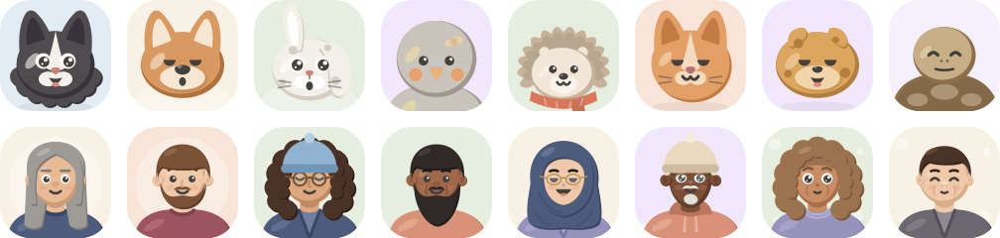
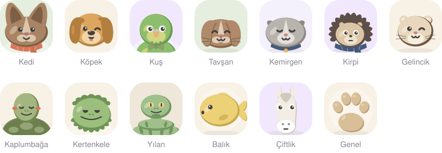
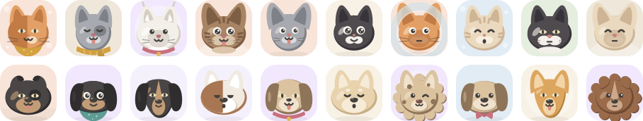
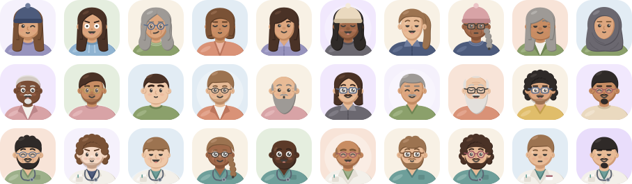
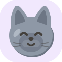

# Pofuduk

Vetaryo için kil kıvamında avatarlar: fotoğrafı olmayan her hasta (evcil hayvan) ve her kişi (müşteri, personel) için seed'den her seferinde aynı avatarı üretir. Avatarlar bitmiş resimlerden değil, üst üste takılan SVG parçalarından oluşur.

<p align="center"></p>

- **Hayvanlar:** 13 tür, 290 parça. Türler: kedi, köpek, kuş, tavşan, kemirgen, kirpi, gelincik, kaplumbağa, kertenkele, yılan, balık, çiftlik ve genel.
- **İnsanlar:** 102 parça. Kadın ve erkek setleri, üç yaş grubu, 8 ten tonu, başörtüsü, personel kıyafetleri.
- Bağımlılık yok. Parçalarda yalnızca `path`, `circle`, `ellipse`, `rect` var; filter, mask, clipPath ve degrade kullanılmıyor. Bu yüzden react-native-svg ile de aynen çizilir.

## Örnekler

### 13 tür

Türü bilinmeyen hayvanlar için "Genel" var. Kedi ve köpekte en çok çeşit bulunuyor.



### Kedi ve köpek

Her satır farklı seed'lerle üretildi. Kafa, kulak, desen, göz, ağız, renk ve aksesuar seed'den seçiliyor.



### İnsanlar

Üstten alta: kadın, erkek ve personel (`role: 'staff'`). Yaş da seed'den geliyor; yaşlılarda kır saç, kel ve sakal daha sık çıkıyor. Personelde önlük ya da forma, stetoskop ve yaka kartı var.



### Kod ve çıktısı

| Kod | Çıktı |
| --- | :---: |
| `renderPetAvatar('pet_7f3a', 'cat', pets)` |  |
| `renderHumanAvatar('owner_19c2', { gender: 'female' }, humans)` |  |
| `renderHumanAvatar('user_04be', { role: 'staff' }, humans)` |  |

Bu görseller `node scripts/docs.mjs` ile üretilir.

## Dosyalar

| Dosya | Ne |
| --- | --- |
| `dist/pet-avatars.json` | Hayvan kütüphanesi |
| `dist/human-avatars.json` | İnsan kütüphanesi |
| `src/render.ts` | Birleştirici: `renderPetAvatar`, `renderHumanAvatar` |
| `src/pets.mjs`, `src/humans.mjs`, `src/shared.mjs` | Parçaların kaynağı; JSON buradan üretilir |
| `scripts/build.mjs` | JSON'u üretir, kuralları denetler, `dist/preview.html` yazar |
| `scripts/docs.mjs` | README görsellerini (`docs/*.svg`) üretir |

## Kullanım

```ts
import pets from 'pofuduk/dist/pet-avatars.json';
import humans from 'pofuduk/dist/human-avatars.json';
import { renderPetAvatar, renderHumanAvatar } from 'pofuduk/src/render';

const petSvg = renderPetAvatar(pet.id, 'cat', pets);
const ownerSvg = renderHumanAvatar(owner.id, { gender: 'female' }, humans);
const vetSvg = renderHumanAvatar(user.id, { role: 'staff' }, humans);

// 
// React Native: <SvgXml xml={petSvg} />
```

Çizim iki adımdan oluşur. Seçimi saklayıp sonradan elle değiştirmek isterseniz adımları ayrı çağırın:

```ts
const choice = selectPetAvatar(seed, 'dog', pets); // { parts: { head: 'dog-head-long', … }, colors: { fur: '#…' } }
choice.parts.accessory = 'acc-cone';               // ameliyat sonrası konik yaka
const svg = composePetAvatar(choice, pets);
```

## Kurallar

- Bütün parçalar aynı `viewBox="0 0 256 256"` tuvalinde, doğru yerinde çizilir; katmanlar üst üste konunca kendiliğinden hizalanır.
- Hayvan katman sırası: `background, head, ears, pattern, eyes, nose, mouth, whiskers, accessory`.
- İnsan katman sırası: `background, body, hairBack, head, ears, ageLines, eyes, eyebrows, nose, mouth, facialHair, hairFront, glasses, accessory`. `ageLines` brifte yoktu; yaşlılar için kırışık yerine tek sade çizgiyi bu katman taşıyor.
- Renk yer tutucuları:
  - **Hayvan:** `{{fur}} {{furDark}} {{furLight}} {{accent}} {{bg}}`
  - **İnsan:** `{{skin*}} {{hair*}} {{clothes*}} {{accent}} {{bg}}`, ayrıca başörtüsü ve bere için `{{scarf}} {{scarfDark}} {{scarfLight}}`.
- Göz, ağız ve bıyık sabit `#44403C`. İnsan kaşları saç renginin koyu tonunu alır.
- **Yüz yerleşimi:**
  - Hayvan yüz parçaları (128,150), insan yüz parçaları (128,120) merkezine göre çizilir.
  - Yüzü farklı yerde olan kafalar `faceAnchor`, burnu farklı yerde olanlar `muzzleAnchor` taşır.
  - Hayvan kafaları desenler için iki yol daha taşır: `half` (iki renkli yüz) ve `muzzle` (koyu burun maskesi). Desenlerdeki `{{half}}` ve `{{muzzle}}` bunlarla dolar.
- **Tür listeleri:**
  - Bir türün kullandığı katmanlar `species.<tür>.layers` içinde. Listede olmayan katman o türde hiç çizilmez; örneğin balıkta burun ve bıyık yok.
  - Türün kendi listesi varsa o kullanılır, yoksa `shared` altındaki liste.
- **Otomatik seçim kuralları:**
  - `palette.dark` ya da `skin.dark` olunca yalnızca göz akı olan gözler seçilir; koyu gözler koyu tüyde kaybolmaz.
  - `hairBack.pairsWith` arka saçı ön saça bağlar.
  - `excludes` uymayan parçaları dışarıda bırakır; başörtüsüyle küpe ve bere seçilmez.
  - `role: "staff"` istenirse yalnızca önlük ve forma seçilir. `palettes` alanı formanın renklerini adaçayı, lacivert ve petrol ile sınırlar.
- `weight` seçilme sıklığıdır. `weightByAge` ağırlığı yaşa göre değiştirir (kır saç, kel, sakal). "Yok" seçenekleri bilerek ağırdır.

## Derleme

```bash
node scripts/build.mjs            # JSON + dist/preview.html
node scripts/build.mjs --sheets   # + tasarım tuvali için dist/sheets/*.svg
```

Derleme her parçayı denetler: tek `<g>`, izin verilen etiketler, `class`/`style`/`url(` yok, her arka saçın bir ön eşi var. İhlal varsa durur.

Bilinen sınır: briften uzun parçalar var. Kafa parçaları hacim katmanlarıyla birlikte 300–1600 karakter tutuyor; en uzunu koyun kafası (yün yumakları).
